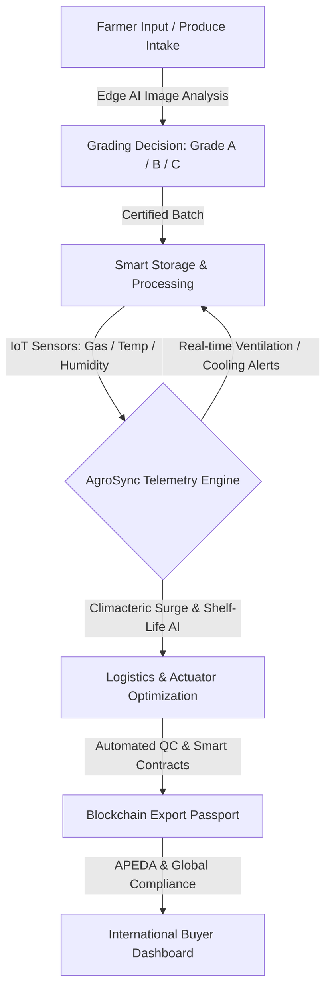

# -Agro-Processing-and-Value-Chain-Including-Marketing-and-Export

# AgroSync AI: Integrated Value Chain & Export Intelligence
> **"From Farm-Gate to Global-Market"** — A Cyber-Physical System (CPS) transforming the agricultural post-harvest value chain into a high-value, transparent, and export-ready engine.

---

## 📌 Executive Summary

**AgroSync AI** addresses the 30–40% post-harvest loss in horticulture (mangoes, pomegranates, grapes, onions) caused by blind storage, subjective grading, and unverified supply chains.

By combining **Edge AI grading**, **IoT post-harvest micro-climate monitoring**, and a **Blockchain-backed Export Passport**, AgroSync empowers farmers, Farmer Producer Organizations (FPOs), and cold-chain exporters with actionable intelligence to ensure APEDA compliance, minimize rejects, and command premium global prices.

---

## 🌟 Core Value Pillars

1. **Edge AI Quality Grading:** Real-time, offline-capable visual quality assessment (size, color, defect detection) at the farm and warehouse gate.
2. **Predictive Post-Harvest Monitoring:** IoT-driven shelf-life prediction correlating Ethylene ($C_2H_4$), $CO_2$, temperature, and humidity to detect climacteric surges 48 hours in advance.
3. **Blockchain Export Passport:** Decentralized, tamper-proof ledger recording the product journey from soil health to phytosanitary and grading certifications for global buyer trust.
4. **Market & Export Intelligence Engine:** AI-driven forecasting for international export demand surges, optimal pricing, and logistics routing.

---

## 🏗️ System Architecture



---

## ⚙️ Cyber-Physical Hardware Layer

### 1. Edge AI Vision Node
* **Processor:** ESP32-S3-WROOM-1 (with Vector AI instructions) or NVIDIA Jetson Nano.
* **Camera Sensor:** OV2640 / IMX219 wide-angle lens.
* **Inference Model:** INT8-quantized MobileNetV2 / YOLOv8-tiny running on-device via TensorFlow Lite for Microcontrollers.
* **Capabilities:** Pixel-to-metric size mapping, color ripeness classification, and surface defect/fungus detection with >95% accuracy.

### 2. Multi-Sensor Storage & Crate Node
* **Gas Telemetry:** Sensirion SGP30 (TVOC & equivalent $CO_2$ as Ethylene proxy) and MQ-3 (fermentation detection).
* **Environmental Sensing:** BME280 precision temperature, relative humidity, and barometric pressure.
* **Weight Monitoring:** 50kg load cells with HX711 24-bit ADC amplifier for crate weight loss tracking.
* **Power System:** 5W solar harvesting panel with 18650 Li-ion battery (TP4056 management) for autonomous operation in remote facilities.

### 3. Actuator & Industrial Control
* **Actuation Logic:** PID-controlled relay for solar dehydrators and automated forced-air ventilation upon $CO_2$ or Ethylene threshold spikes.

---

## 💻 Software & Industrial Tech Stack

| Layer | Technologies |
|---|---|
| **Frontend UI / UX** | React 19, Vite, TypeScript, Tailwind CSS, Framer Motion, Lucide Icons, Recharts |
| **Interactive Dashboards** | Standalone HTML5/ES6 real-time monitoring and presentation consoles |
| **Edge & Embedded** | FreeRTOS, ESP-IDF, MicroPython, TensorFlow Lite Micro, C++ |
| **IoT Protocols** | MQTT (HiveMQ / EMQX), LoRaWAN (868/915 MHz), WebSockets |
| **Backend & AI** | Python (FastAPI), PyTorch, Scikit-Learn |
| **Database & Analytics** | InfluxDB (Time-series telemetry), PostgreSQL / PostGIS (Spatial metadata), Redis |
| **Traceability & Trust** | Smart contracts (Solidity / Hyperledger Fabric DID architecture) |

---

## 📂 Repository Structure

```
├── README.md                              # Project documentation & architecture
├── package.json                           # Root workspace configuration
├── agrosync_interactive_dashboard.html    # Standalone interactive operations dashboard
├── agrosync_presentation.html             # Pitch & architecture presentation console
├── generate_ppt.py                        # Automated slide deck generator script
└── agro-sync/                             # React + Vite + TypeScript application
    ├── package.json
    ├── vite.config.ts
    ├── tailwind.config.js
    ├── tsconfig.json
    └── src/
        ├── App.tsx                        # Main dashboard & telemetry interface
        ├── App.css
        ├── index.css
        └── main.tsx
```

---

## 🚀 Getting Started

### Prerequisites
* Node.js (v18+)
* npm or pnpm
* Python 3.9+ (optional for helper scripts)

### Installation & Running Frontend
```bash
# Install dependencies
npm install --prefix agro-sync

# Start the development server
npm run dev --prefix agro-sync
```

Visit `http://localhost:5173` to explore the AgroSync AI live monitoring dashboard.

---

## 📈 Impact & Export Value Proposition

* **25% Reduction in Post-Harvest Losses:** Early detection of climacteric peaks prevents rotting in transit.
* **1.5× Farmer Realization:** Verified Grade-A produce commands premium export pricing.
* **Zero-Trust Traceability:** End-to-end QR/Blockchain passport simplifies APEDA clearance and phytosanitary verification for EU and Middle East markets.
